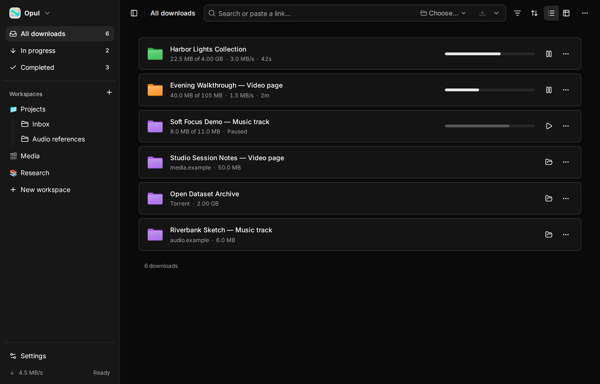

<p align="center">
  
</p>

<h1 align="center">Opul</h1>

<p align="center"><strong>A macOS download manager with workspaces for BitTorrent and video/audio page downloads.</strong></p>

<p align="center">
  For Mac users who download torrents and media pages and want them organized, Opul puts BitTorrent and yt-dlp in one workspace-based library—unlike Folx and other torrent-only clients—because workspaces, active/completed views, and mixed source types are first-class.
</p>

<p align="center">
  
</p>

## What it is

Opul is a simple Mac app for people who regularly download **both torrents and video/audio pages** and care about keeping them organized—not just queued.

- **Workspaces** group downloads by project or topic (emoji-labeled folders in the sidebar)
- **BitTorrent and page downloads** share one library, with In progress and Completed views
- **Optional video tools** wrap the official [yt-dlp](https://github.com/yt-dlp/yt-dlp) script for video pages and music tracks; torrents and direct links work without that setup
- **Built-in FFmpeg** handles merges and common audio/video post-processing on macOS 13+

Built with Tauri, React, and a Rust download core. Stack details matter for contributors; the product story above is what the app is for.

## Install

Download the latest macOS disk images from the [Latest release](https://github.com/slovakian/opul/releases/latest):

- [Opul-arm64.dmg](https://github.com/slovakian/opul/releases/latest/download/Opul-arm64.dmg) — Apple Silicon
- [Opul-x64.dmg](https://github.com/slovakian/opul/releases/latest/download/Opul-x64.dmg) — Intel

Open the DMG and drag Opul into Applications. Opul can check for updates from Settings ▸ Updates. See [Opul updates](docs/app-updates.md).

## Develop

Install Xcode Command Line Tools, a stable Rust toolchain, Node.js 24+, and the [Vite+ CLI](https://viteplus.dev/guide/). See [toolchain setup](docs/toolchain.md).

```bash
vp install --frozen-lockfile
pnpm exec tauri dev
```

`vp run dev` runs only the web interface; downloads need the native shell. Optional video tools are configured in Settings ▸ Tools after consent—see [video tools](docs/video-tools.md) and [built-in tools](docs/built-in-tools.md). Licenses and sources: [third-party notices](THIRD_PARTY_NOTICES.md).

Isolated data for development:

```bash
OPUL_DATA_DIR=/tmp/opul-dev-state OPUL_DOWNLOAD_DIR=/tmp/opul-dev-downloads pnpm exec tauri dev
```

## Verify

```bash
pnpm exec playwright install webkit
Scripts/test.sh
Scripts/package_app.sh debug
Scripts/smoke_test.sh
```

Release app and disk image:

```bash
Scripts/package_app.sh release
Scripts/package_dmg.sh
```

Architecture targets (`--target aarch64-apple-darwin` or `x86_64-apple-darwin`) produce `Opul-arm64.dmg` / `Opul-x64.dmg`. Packaging notes: [releasing](docs/releasing.md). Interface migration decision: [ADR 0004](docs/adr/0004-tauri-interface.md).

Regenerate the README hero screenshot (Chromium + mocked library):

```bash
pnpm exec playwright test --config playwright.readme.config.ts
```

## License

Opul is free and open source under the [MIT License](LICENSE). [Support development](https://github.com/sponsors/slovakian).
