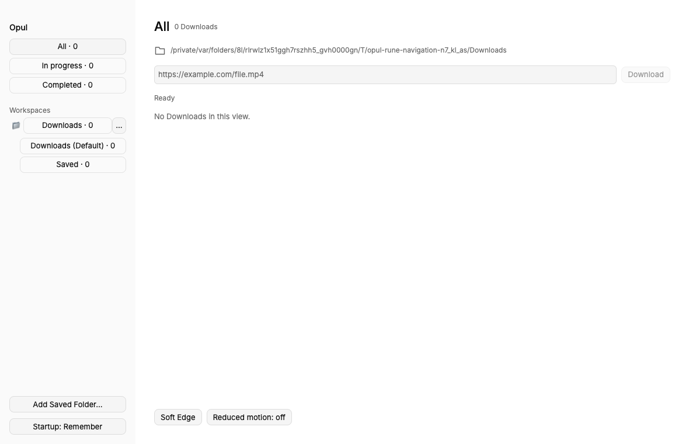
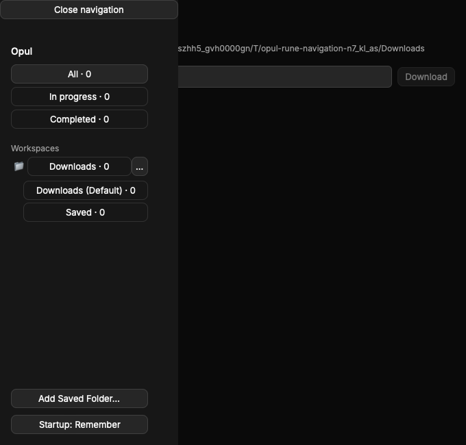

# Rune library navigation

Issue [#104](https://github.com/slovakian/opul/issues/104) builds on the production [direct-file shell](direct-download.md). Run `Scripts/package-rune.sh` and open `.build/rune/Opul Rune.app`.

The initial location is All. All, In progress, Completed, Workspace and Saved Folder views read the same core projection. The predicates that render rows also compute their counts. In progress includes waiting, queued, starting, fetching, processing, verifying and pausing. Completed includes finished, seeding, not seeding and checking complete files, matching the recorded frontend baseline.

Workspace navigation uses its default Saved Folder; child navigation uses that child's identity. The destination line and submitted direct-file command use that same resolved folder. Aggregate views have the default destination when exactly one Workspace exists. With several Workspaces, select a Workspace or Saved Folder before submitting. Configurable aggregate intake, temporary destinations and organization editing remain #105.

A one-folder Workspace is a simple row. A multiple-folder Workspace replaces its leading icon with an independently named disclosure when hovered or keyboard focused. Workspace navigation, disclosure, each folder and the actions menu are separate controls. The actions menu supports adding a Saved Folder to its own Workspace even when another location is selected. The native picker retains that Workspace identity until its command settles. The default-folder label comes from the core and is not changed by adding another folder.

The owned button supports Enter and Space. Disclosures also accept Left and Right. Menu items use Rune's roving focus, Escape/outside dismissal and trigger restoration. Below 820 points the Library button opens a modal navigation panel. Disclosure keeps it open; selecting a location closes it. Escape dismisses an inner actions menu first, then the panel, returning focus to Library. Wider layouts reuse the same session state. The actual window minimum is 560 × 540 points.

## Expansion persistence

Rune stores presentation preferences in `navigation-preferences.json` inside `OPUL_RUNE_DATA_DIR` (normally `~/Library/Application Support/Opul Rune`). The command worker reads and atomically writes the file; the UI never performs disk I/O. This file belongs to sidebar navigation. Broader Settings persistence remains #113.

Remember restores each Workspace's independent choice. Start collapsed applies only on the next launch and leaves remembered choices intact. Changing the startup policy never collapses the current session. Returning to a single-folder row retains its dormant expansion choice. Confirmed Workspace deletion removes its preference entry; disappearance of a selected folder normalizes to its surviving parent, and loss of a Workspace normalizes to All. Older sequence numbers and foreign boot identities cannot retire current locations.

Session choices made before a successful preference read override the restored entries. Failed reads remain retryable without writing defaults over an unreadable file. Writes are serialized and carry a generation; older acknowledgements cannot replace newer choices or deletion tombstones. A failed save leaves the current session usable and exposes Retry navigation preferences. Retry writes the latest desired values. Live telemetry does not initiate repeated saves or reset input, selection, expansion or open menus.

## Verification

```sh
CARGO_INCREMENTAL=0 CARGO_PROFILE_DEV_DEBUG=0 CARGO_BUILD_JOBS=2 \
  cargo test --locked -p opul-rune
python3 Scripts/check-rune-navigation.py
python3 Scripts/check-rune-app.py --skip-build
```

The production Rune runtime tests dispatch actual pointer and keyboard input. The two-Workspace journey filters real loopback HTTP transfers, checks counts, breadcrumbs, default identity and submitted destination, and compares output bytes. Separate journeys exercise malformed-file repair, rapid toggles, real atomic-write failure/Retry, fresh core/library opens, narrow remounts, nested Escape and focus restoration. Projection-delivery tests cover live rename/reorder, missing selections, dormant expansion and stale rejection; a real core Workspace deletion followed by reopening checks cleanup on disk. Small preference-state tests cover delayed-read merging in both startup modes and older save acknowledgements arriving after newer intent.

`check-rune-navigation.py` copies the signed bundle outside the repository and runs four fresh processes with isolated data. It uses macOS accessibility and NSOpenPanel, resizes the actual window, checks nested Escape and navigation behavior, changes startup policy, forces a real write failure with a directory at the atomic temporary path, retries the latest choice, and verifies Quit and last-window close. Generated evidence stays in `.build/rune/navigation-evidence`; the printed temporary library remains available for inspection.

Native accessibility automation requires the invoking terminal's existing macOS accessibility permission. These checks establish the tested host's behavior; they do not establish physical Intel, macOS 13, release signing, notarization or VoiceOver parity. Those remain #118's acceptance gates.

## Validation record

Verified on macOS 26.2, Apple Silicon, rustc 1.99.0 and SDK 26.5. The signed debug bundle reports macOS 13.0 as its Mach-O minimum. This does not establish execution on macOS 13.

`vp install`, `vp check`, `vp test` (107 tests), `vp run build` (including TypeScript), `vp run features:check`, `cargo fmt --all --check` and strict Rune Clippy passed. Final Rust workspace validation passed 266 tests: 207 core, 43 desktop and 16 Rune, with two existing ignored desktop tests. The final workspace run used `-- --test-threads=2`. The first unrestricted workspace run timed out in two unchanged media fixture handoffs; both passed with all 41 media tests on focused rerun, and the final workspace run was green.

The unchanged full WebKit run passed 273/276. Failures were `custom-treatment.spec.ts:146`, `custom-treatment.spec.ts:221` and `saved-folder-additions.spec.ts:23` (the search/selected/one-folder case). All three passed in single-worker reruns. This remains an unstable full-suite result, not a green parity claim. Full-run and rerun logs stay in `.build/rune/validation-104`; #118 retains the suite-stability gate.

The initial aggregate regression failed on the old shell with `missing nav-all`. The final focus regression failed with `retiring a focused folder should return focus to its Workspace`, then passed after adding child-level focus return. Standards review reported no findings. Spec review found the only-folder picker normalization gap; the fix and final diff were re-reviewed with no remaining findings.

The final signed-bundle navigation journey passed all four fresh processes, native picker and 680/1180-point widths, both startup policies, nested dismissal, forced atomic-write failure/latest-choice Retry, Command-Q and last-window close. Retained evidence: [result](evidence/navigation/result.json), [native wide tree](evidence/navigation/wide.txt), [native narrow tree](evidence/navigation/narrow.txt), [recovered tree](evidence/navigation/recovered.txt), and [saved preferences](evidence/navigation/preferences.json). The renderer captures below reopen that same library; they are separate from the native-input evidence.





Also retained: [wide dark](evidence/navigation/wide-dark.png) and [narrow light](evidence/navigation/narrow-light.png).

The rebuilt bundle also passed `python3 Scripts/check-rune-app.py --skip-build`: native folder selection, two byte-exact 8,224,768-byte Downloads, pause/resume, deliberate-hold preservation and running-intent restoration in a fresh process, with stable IDs and both quit routes. The [result and payload digest](evidence/navigation/direct-download-result.json) record this run.
