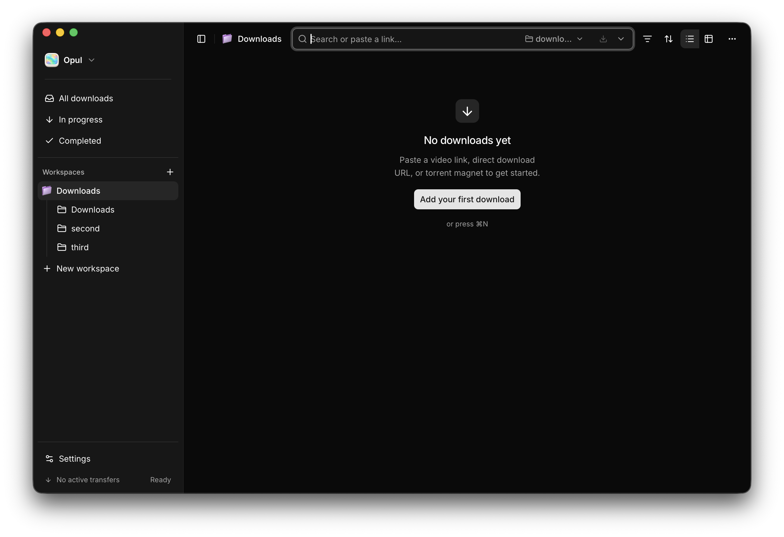
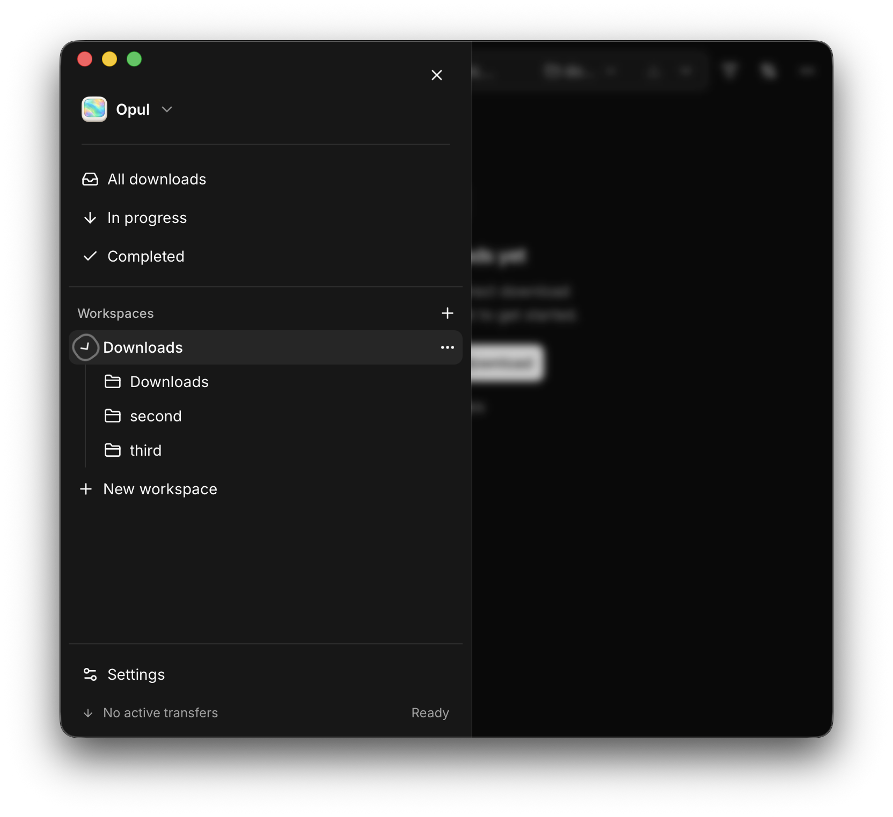

# Integrated workspace sidebar verification

Issue [#52](https://github.com/slovakian/opul/issues/52), verified on macOS 26.2, Apple Silicon, 2026-11-01. The source of truth is [#43](https://github.com/slovakian/opul/issues/43), with design decisions in [#42](https://github.com/slovakian/opul/issues/42). This pass started from `origin/int/43-workspace-sidebar` at `1c025be0ed6fb8b9865843f48ded493ac3295edd`, after blocking issues #50 and #51 closed. Parent #43 remains open and unchanged.

## Coverage audit

| Behavior | Evidence in `tests/ui/` |
| --- | --- |
| Mixed simple and expandable rows, long names, empty folders, persistent artwork, independent named controls | `workspace-sidebar.spec.ts`, `workspace-branches.spec.ts`, `appearance.spec.ts` |
| Actual filtered downloads, breadcrumb parent navigation, parent/child selection, query preservation, contextual and temporary destinations, real submitted command destinations | `workspace-branches.spec.ts`, `destination.spec.ts`, `unified-header.spec.ts` |
| Both addition entry points, second/third folder, other workspaces, default-folder preservation, picker cancel/error, rejected/null receipts, confirmation ordering, delayed and failed refresh | `saved-folder-additions.spec.ts`, `saved-folder-confirmation.spec.ts` |
| Immediate/deferred/rejected removals, surviving/removed selected folder, two-to-one normalization, unrelated views, missing destinations, transient/stale snapshots, disappearing-control focus | `workspace-removal.spec.ts` |
| Both startup modes, old defaults, independent choices, dormant entries, polling, rename/reorder, responsive remounts, rapid toggles, failed writes and explicit Retry | `workspace-expansion.spec.ts`, `workspace-branches.spec.ts` |
| Confirmed deletion, pending/failed cleanup, stale snapshots, in-flight responses, latest-choice Retry | `workspace-expansion-cleanup.spec.ts` |
| Delayed reads in both startup modes with early toggles and additions through both entry points; failed reads and explicit Retry; Settings/display/expansion response ordering | `workspace-preference-lifecycle.spec.ts`, added in this pass |
| Keyboard-only operation, Axe checks, focus restoration, narrow sheets, reduced motion | `workspace-sidebar.spec.ts`, `workspace-branches.spec.ts`, `workspace-removal.spec.ts`, `responsive-header.spec.ts`; all browser tests use `reducedMotion: "reduce"` |

The eight new WebKit cases exercise the existing rendered-app seam. Preference responses are cloned before being held, so a late response represents its original committed value. Delayed reads hold both development Strict Mode startup reads until explicitly released. Session storage models the browser fixture only.

Real durability uses `PreferenceStore::open` on actual temporary files. Existing tests cover old files, stale Settings drafts, atomic write failure/retry, and deletion cleanup. The new `concurrent_settings_display_and_expansion_writes_survive_file_reopen` test races all three live mutation paths behind a barrier, then reopens the file and checks startup policy, independent display settings, latest expansion, dormant choices, and deletion.

## Commands and outcomes

Run from the repository root:

```sh
git fetch origin
git merge --ff-only origin/int/43-workspace-sidebar
vp install
vp check
vp test
vp run build
vp run test --project=webkit tests/ui/workspace-sidebar.spec.ts tests/ui/workspace-branches.spec.ts --workers=2
vp run test --project=webkit tests/ui/workspace-preference-lifecycle.spec.ts --workers=2
vp run test --project=webkit --workers=2
cargo test --manifest-path src-tauri/Cargo.toml preferences
cargo fmt --all --check
cargo check
cargo test --workspace
scripts/test_packaging.sh
scripts/package_app.sh debug
scripts/smoke_test.sh
```

All passed. Results: 37 frontend unit tests, 9 focused sidebar/branch tests, 8 new lifecycle cases, 194 full WebKit tests, 8 desktop preference tests, and 119 full Rust workspace tests. The full WebKit run took 3.6 minutes with two workers. No browser retries were configured. Packaging produced an ad hoc signed arm64 debug app; the smoke test checked the app icon and confirmed the packaged frontend connected to a running Rust library.

## Isolated native verification

The native run used the packaged WKWebView app and real Tauri commands. It did not install an IPC mock or modify the user's normal application data. Only disposable folders were added to the final test library. No downloads were submitted to personal folders.

```sh
mkdir -p /tmp/opul-52-native/state /tmp/opul-52-native/downloads
mkdir -p /tmp/opul-52-native/second /tmp/opul-52-native/third
env OPUL_DATA_DIR=/tmp/opul-52-native/state \
  OPUL_DOWNLOAD_DIR=/tmp/opul-52-native/downloads \
  OPUL_SMOKE_READY_FILE=/tmp/opul-52-native/ready \
  Opul.app/Contents/MacOS/Opul \
  > /tmp/opul-52-native/launch.log 2>&1
```

The command runs until the app quits. Each relaunch used those same isolated directories and a fresh process. Controls were operated through macOS accessibility with `osascript`; captures used the actual Opul window, not the whole display:

```sh
osascript -e 'tell application "System Events" to tell process "Opul" to get entire contents of window 1'
osascript -e 'tell application "System Events" to tell process "Opul" to set size of window 1 to {720, 650}'
osascript -e 'tell application "System Events" to tell process "Opul" to click menu item "Quit Opul" of menu 1 of menu bar item "Opul" of menu bar 1'
```

Observed native results:

- The initial Downloads workspace had a simple row with automatic folder artwork and no branch. Sidebar Add saved folder opened the real native picker. Choosing the isolated `second` directory expanded the branch and selected `Downloads › second`, with `second` as the contextual destination. Canceling a subsequent picker left the view and remembered choice intact.
- Search-bar Add new location selected the isolated `third` directory as a temporary destination while the breadcrumb remained `Downloads › second`. Reopening `application-state.json` confirmed three saved folders and the original default-folder identity.
- At 720 × 650, disclosure left the navigation sheet open. Selecting `second` navigated and closed the sheet. Widening restored the same session expansion.
- Changing the folder artwork to Violet rendered the same treatment in the sidebar and header. Automatic and explicit preset treatments were both exercised.
- Settings Save changed the next-launch mode without changing the current expanded branch. After quitting through the native Quit Opul menu and launching a fresh process, Remember previous state restored the branch. Start collapsed hid its children while leaving the remembered `true` entry untouched on disk. Session interactions remained usable afterward.
- Creating a directory at `state/desktop-preferences.json.tmp` forced a real atomic-write failure. The app retained its session choice, kept the prior stored expansion map, and displayed Couldn't save workspace expansion with Retry. Removing that directory and pressing Retry persisted the pending choice. Actual preference files were reopened after these actions.

The retained local artifacts are under `/tmp/opul-52-native`, including accessibility captures, launch logs, and preference snapshots. Screenshots below show the isolated native app.





## Limits

Native picker success and cancellation were reproducible. An operating-system picker exception was not reproducible; the WebKit addition suites cover rejected picker promises and rejected commands separately. Browser reload/session-storage tests establish frontend lifecycle behavior; actual PreferenceStore reopen tests and native process relaunches establish file durability. No release or main-branch merge was performed.
